# LIFE & MONEY · 금융 인생 보드게임

> 25세부터 60세까지, 선택으로 만드는 금융 인생
> 고등학교 **통합사회** 수업을 위해 만든 생애주기 금융 시뮬레이션 게임

**▶ 바로 플레이하기: https://kh31isle-prog.github.io/financial-life-simulator/**
**👩‍🏫 교사용 결과 모아 보기: https://kh31isle-prog.github.io/financial-life-simulator/teacher.html**

설치나 회원가입 없이 크롬 같은 웹브라우저에서 바로 열려요. 인터넷이 없는 교실에서는 `index.html` 파일을 내려받아 열어도 똑같이 동작해요.

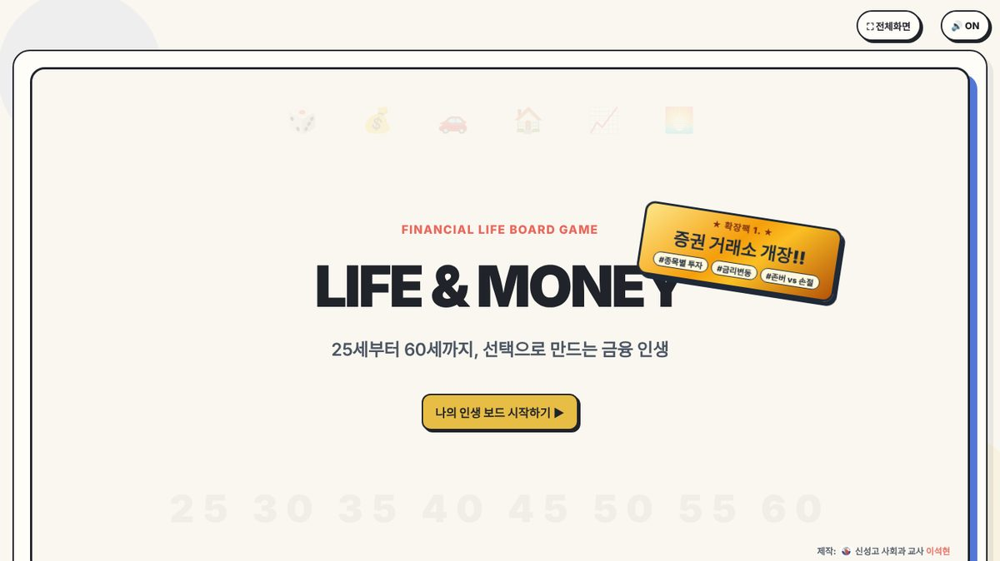

---

## 어떤 게임인가요?

학생은 캐릭터와 직업군, 생활 방식, 금융성향, 재무목표를 고른 뒤 보드 위를 나아가며 35년의 금융 인생을 살아 봐요. 해마다 소득과 지출, 물가와 금리가 바뀌고, 중요한 해에는 결혼·출산·육아휴직·내 집 마련·직업 사건 같은 선택을 해야 해요. 45세에는 지난 목표를 점검하고 인생 후반전 목표를 새로 세우고, 60세가 되면 지금까지의 선택이 결과로 돌아와요.

| 캐릭터 선택 (남녀 각 3명) | 직업군 선택 | 인생 보드 |
|---|---|---|
|  | 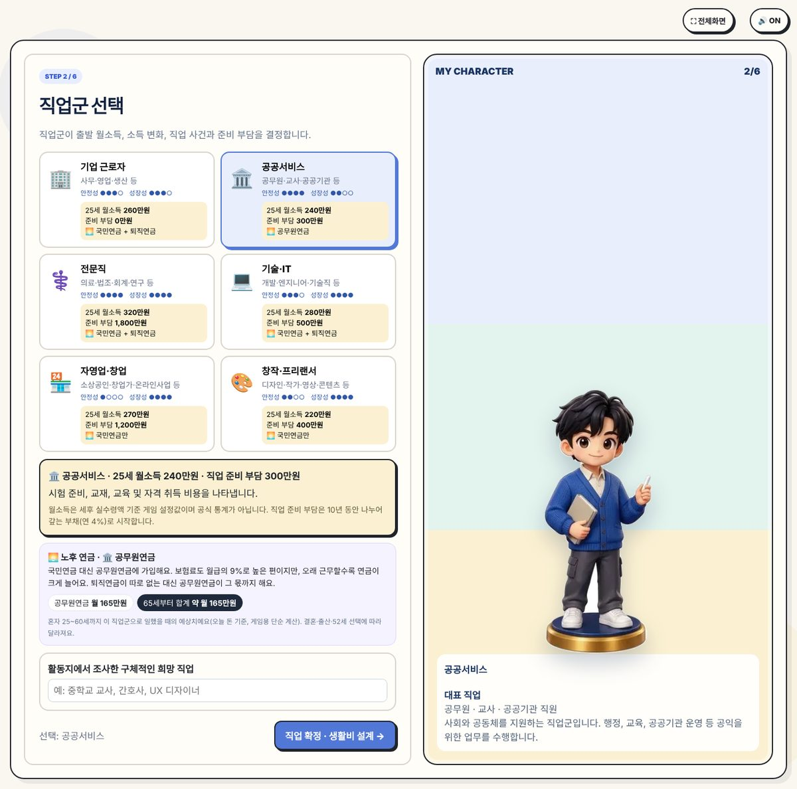 | 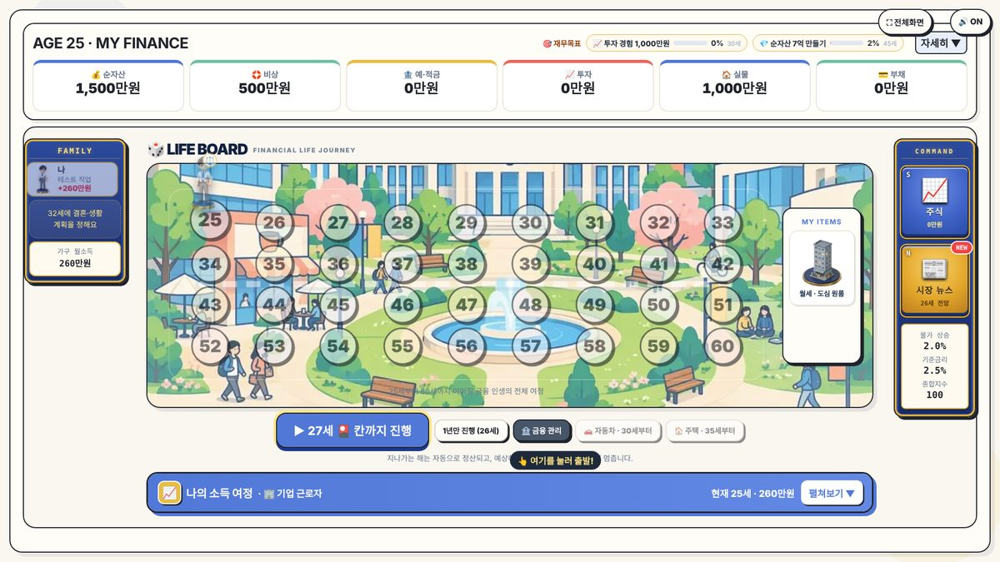 |

### 게임 속에서 배우는 것

- **소득과 지출 설계:** 고정·변동 생활비, 월여유, 비상자금
- **생애주기 재무설계:** 단기(30세) · 중기(45세) · 장기(60세) 재무목표, 45세 중간 점검
- **저축과 투자:** 예금·적금·채권·주식의 유동성·안전성·수익성 비교, 종목 매매와 지수 펀드 비교
- **위험 관리:** 사고·실직 같은 직업 사건, 보험, 레버리지(빚투)와 반대매매
- **대출과 신용:** 주택대출, 자동차 할부, 신용대출, 신용점수에 따라 달라지는 대출 금리
- **물가와 금리:** 해마다 바뀌는 물가 상승률과 기준금리, 실질금리
- **생애주기와 가족:** 결혼·맞벌이·출산·양육비·반려동물, 육아휴직 선택과 경력단절 위기
- **노후 준비:** 국민연금·공무원연금(1층), 퇴직연금(2층), 연금저축(3층)과 세액공제, 직업군별 연금 차이

| 연금 3층 구조 | 주식 · 레버리지 | 신용점수 |
|---|---|---|
| 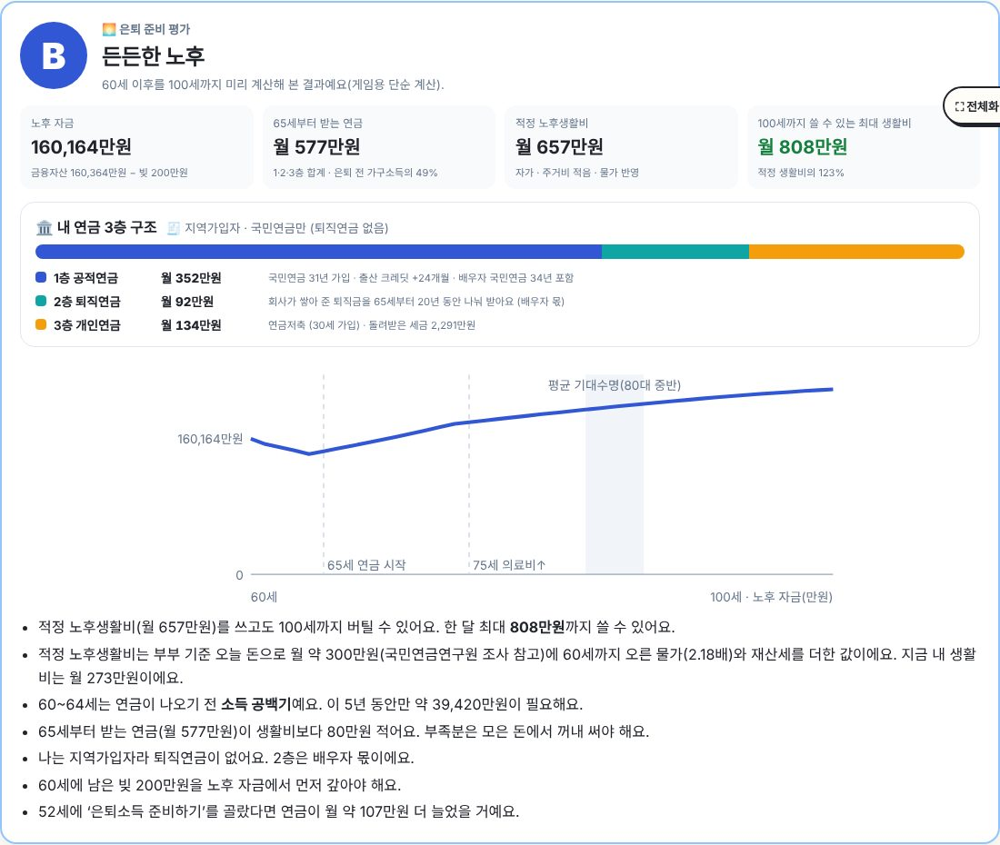 | 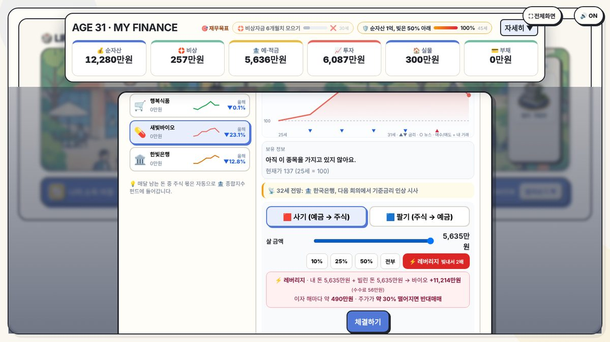 | 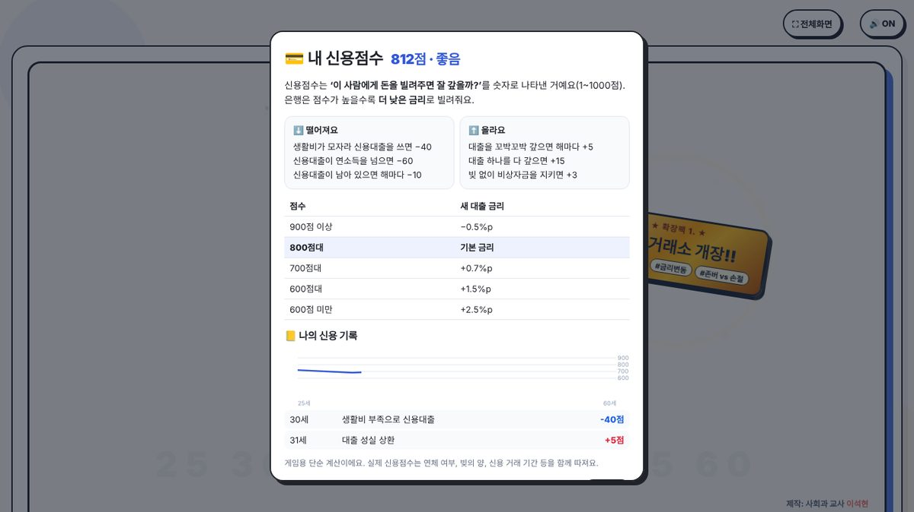 |

| 육아휴직, 누가 할까? | 45세 인생 후반전 목표 |
|---|---|
| 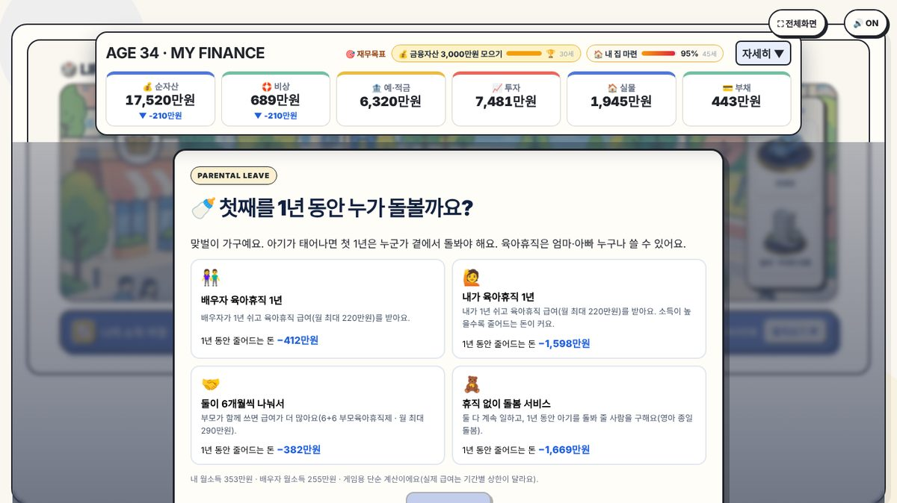 | 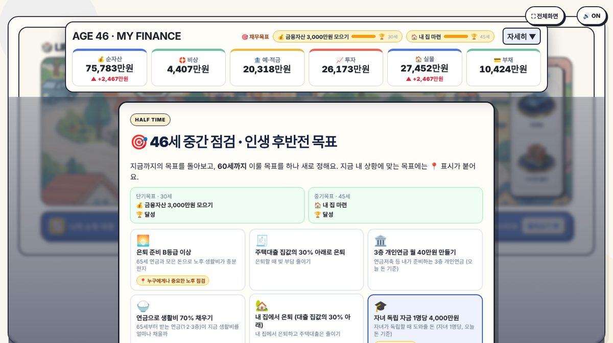 |

> 게임 속 금액과 비율은 수업용으로 단순화한 설정값이에요. 실제 통계나 상품 조건과 다를 수 있어요.

---

## 결과 화면: 순자산보다 '나의 인생 점검'

결과 화면은 순자산이 아니라 **내가 정한 목표를 이뤘는지**로 시작해요. 순자산이 가장 높은 사람이 가장 잘 산 사람은 아니라는 메시지를 담았어요.

- **나의 인생 점검:** 단기·중기·장기 목표 달성, 노후 준비가 충분한지, 아끼며 살았는지 누리며 살았는지(삶의 균형)
- **사회 선생님의 코멘트:** 그 학생의 기록에서 잘한 점과 아쉬운 점을 골라, 교과 개념과 생각해 볼 질문으로 이어 줘요. 학생마다 내용이 달라요.
- **은퇴 준비 평가 · 연금 3층 · 신용점수 · 주식 성적표**
- **나의 투자 습관 분석:** 장기 보유형, 분산 투자형, 한 종목 집중형, 잦은 매매형 등. 거래 횟수와 수수료, 지수 펀드와의 비교를 함께 보여 줘요.

| 나의 인생 점검 | 사회 선생님의 코멘트 |
|---|---|
| 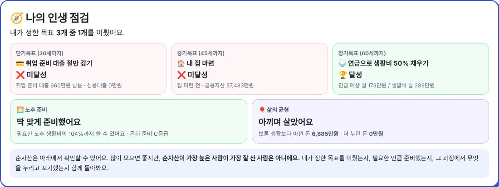 | 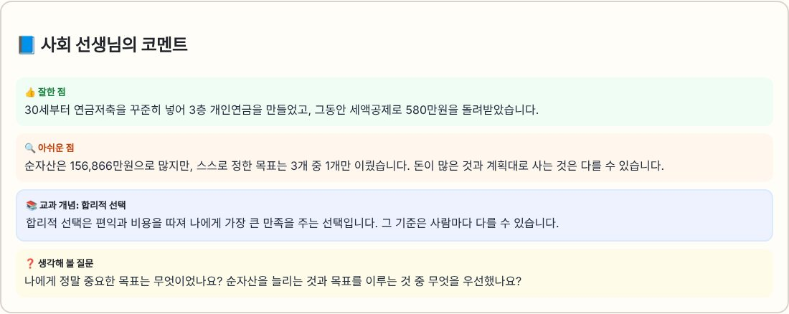 |

---

## 수업에서 쓰는 법 (50분 예시)

| 시간 | 활동 |
|---|---|
| 5분 | 도입: "35년 동안 돈은 어떻게 흘러갈까?" 질문으로 시작 |
| 5분 | 게임 안내: 첫 판에는 말풍선 안내가 자동으로 나와요 |
| 25~30분 | 플레이: 캐릭터 → 직업군 → 생활비 → 금융성향 → 재무목표 → 60세까지 진행 |
| 10분 | 결과 화면의 성찰 질문 작성, 결과 코드 제출 |
| 5분 | 교사용 페이지로 우리 반 결과를 함께 보며 정리 |

- 결과 화면에서 성찰 답변과 함께 **PDF로 저장**할 수 있어요.
- 시간이 남으면 **같은 사건, 다른 선택(LIFE 2)**으로 한 번 더 해 보고 결과를 비교할 수 있어요.
- 노트북·크롬북·태블릿·PC 화면에 맞춰 자동으로 조절돼요. 휴대폰도 되지만 화면이 좁아 보조용으로 추천해요.

---

## 우리 반 결과 모아 보기 (교사용)

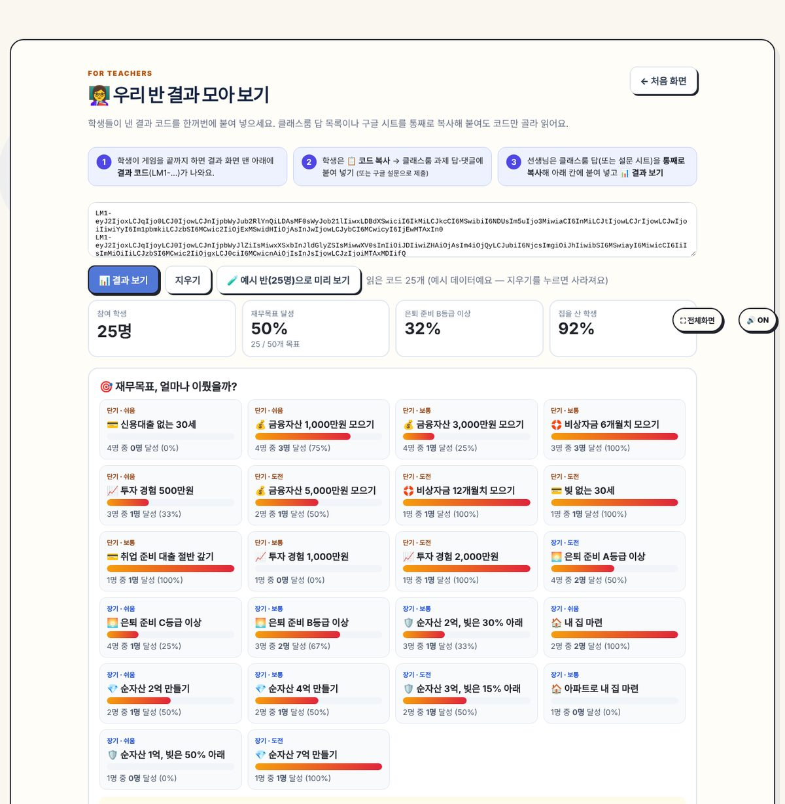

1. 학생이 게임을 끝까지 하면 결과 화면 맨 아래에 **결과 코드**(`LM1-…`)가 나와요.
2. 학생은 **📋 결과 코드 복사** → 구글 클래스룸 과제 답이나 댓글에 붙여 넣어요.
3. 선생님은 [교사용 페이지](https://kh31isle-prog.github.io/financial-life-simulator/teacher.html)에 답 목록을 **통째로** 붙여 넣고 **📊 결과 보기**를 눌러요. 이름 같은 다른 글자가 섞여도 코드만 골라 읽어요.

대시보드에서 볼 수 있는 것:
- 단기·중기·장기 재무목표별 달성률
- 은퇴 준비 등급, 금융성향 분포
- 직접 투자 vs 지수 펀드, **우리 반 투자 습관**(자주 사고판 학생과 그렇지 않은 학생 비교)
- 생활 선택(결혼·자녀·주택·반려동물), 같은 직업끼리 비교
- 토론 질문과 마무리 질문 "순자산이 가장 높은 친구가 가장 잘 산 걸까요?"

도움말:
- 처음이라면 **🧪 예시 반으로 미리 보기**로 어떤 화면이 나오는지 먼저 확인해 보세요.
- **구글 설문으로 받기:** 교사용 페이지 아래 설정에서 설문 링크를 넣고 게임 파일을 고르면, 설문 제출 버튼이 들어간 학생용 파일이 만들어져요.
- 순자산 순위는 매기지 않아요. 결과가 '이기고 지는 것'이 아니라 '어떤 선택이 어떤 결과를 낳았는지'를 함께 보는 데 초점을 두었어요.

---

## 설계 원칙

- **순위를 매기지 않아요.** 스스로 정한 목표와 노후 준비를 기준으로 돌아봐요.
- **성별에 따른 차이를 두지 않아요.** 남녀 캐릭터의 소득과 규칙이 같고, 육아휴직은 누구나 고를 수 있어요. 경력단절 위기도 휴직한 사람이라면 성별과 관계없이 같은 확률로 일어나요. 현실의 격차는 토론 거리로 남겨 두었어요.
- **직업 간 차이는 현실대로 둬요.** 같은 선택이라도 직업에 따라 소득과 연금이 달라진다는 것 자체가 배움이 돼요.

---

## 사용 조건

- 학교 수업과 교육 목적이라면 누구나 자유롭게 사용할 수 있어요.
- 사용하거나 고쳐서 나눌 때는 출처를 밝혀 주세요: **제작 신성고 사회과 교사 이석현**
- 상업적 이용은 허락하지 않아요.

게임 속 그림은 AI 이미지 생성 도구로 만들었어요. 사용 후기나 고칠 점은 [Issues](https://github.com/kh31isle-prog/financial-life-simulator/issues)에 남겨 주시면 큰 힘이 돼요.
